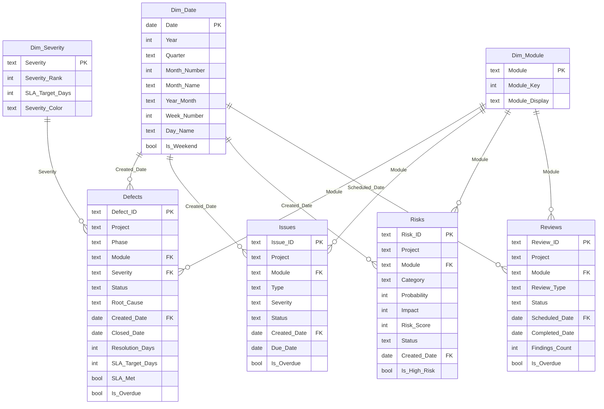

# Project Quality Dashboard

A **Power BI portfolio project** demonstrating end-to-end project quality management analytics for a software defect dataset of 5,000 records. The dashboard covers defect trends, SLA compliance, risk exposure, review status, and audit findings — the core KPI domains of a Project Quality Management role.

> **Status**: Build-in-progress — data pipeline and all assets are complete; dashboard screenshots will be added after assembly in Power BI Desktop.

---

## Business Problem

Quality managers in large-scale IT/software projects need to answer five recurring questions:

1. How many defects are open right now, and is the backlog growing or shrinking?
2. Are we meeting our SLA targets for resolving critical and high-severity defects?
3. Which modules accumulate the most defects, and what are the dominant root causes?
4. What is our current risk exposure, and are high-risk items being tracked?
5. Are quality reviews and audit findings being closed on schedule?

This dashboard provides a structured, data-driven answer to all five questions, with drill-down by module, severity, project phase, and date.

---

## Data Sources

| Table | File | Rows | Origin | Label |
|-------|------|------|--------|-------|
| Defects | `Processed_QA_Defects.csv` | 5,000 | [nitinkishore1509/QA-Defect-Trend-Analysis](https://github.com/nitinkishore1509/QA-Defect-Trend-Analysis) | Real (MIT-licensed) |
| Issues | `issues.csv` | 200 | Generated by `scripts/gen.py`, seed=42 | **SYNTHETIC** |
| Risks | `risks.csv` | 80 | Generated by `scripts/gen.py`, seed=42 | **SYNTHETIC** |
| Reviews | `reviews.csv` | 120 | Generated by `scripts/gen.py`, seed=42 | **SYNTHETIC** |

See `NOTICE` for full attribution and synthetic data disclosure.  
See `docs/data_dictionary.md` for column-level descriptions.

---

## Architecture & Data Model



**Relationship notes**:
- All relationships are **Many-to-One** (fact → dimension), **single cross-filter direction**.
- `Defects[Closed_Date] → Dim_Date[Date]` exists as an **inactive** relationship; the `[Defects Closed by Month]` DAX measure activates it using `USERELATIONSHIP()`.
- `Risks` and `Reviews` cross-filter each other **only through `Dim_Module`** — a slicer on Module will filter both simultaneously.

---

## How to Reproduce

### Prerequisites
- Python 3.9+ with `pandas` installed (`pip install pandas`)
- Power BI Desktop (Windows, free)

### Steps

```bash
# 1. Clone this repository
git clone https://github.com/YOUR_USERNAME/project-quality-dashboard.git
cd project-quality-dashboard

# 2. Generate synthetic data
python scripts/gen.py

# 3. Clean all data
python scripts/clean_data.py
# Verify: data/clean/ should contain 4 CSV files

# 4. Open Power BI Desktop → follow docs/build_guide.md
#    Paste each .pq file from powerquery/ into Advanced Editor
#    Add measures from dax/measures.dax
```

See [docs/build_guide.md](docs/build_guide.md) for the complete step-by-step Power BI instructions.

---

## KPI Definitions

| KPI | Definition | Notes |
|----|-----------|-------|
| Total Defects | Count of all defect records | All statuses |
| Open Defects | Defects with Status = Open, In Progress, or Re-Opened | Deferred excluded by design |
| Closed Defects | Defects with Status = Closed | — |
| Closure Rate % | Closed / Total × 100 | — |
| Avg Resolution Days | Mean of (Closed_Date − Created_Date) for closed defects | — |
| SLA Compliance % | % of closed defects resolved within SLA_Target_Days | SLA: Critical=2d, High=5d, Medium=10d, Low=20d |
| Cumulative Backlog | Running total of Created − Closed defects | Time-series |
| High Risks | Open/Escalated risks with Risk_Score ≥ 15 | Risk_Score = Probability × Impact (max 25) |
| Review Completion % | Completed reviews / Total reviews × 100 | — |
| Overdue Action Items | Action items past Due_Date and not Closed | — |
| Audit Findings Open | Audit findings not yet closed | — |

---

## Dashboard Pages

| Page | Description |
|-----|-------------|
| 1 – Executive Summary | KPI cards, created-vs-closed line, backlog area, slicers |
| 2 – Defect Analysis | Severity donut, module bar, heatmap matrix, resolution by severity |
| 3 – Risks & Reviews | Risk scatter, risk by status, review by type, overdue table |
| 4 – Action Items & Audit | Overdue table, findings by gate, root cause bar |

---

## Screenshots

> **Note**: Screenshots will be added after the dashboard is assembled in Power BI Desktop.

| Page | Screenshot |
|-----|-----------|
| Executive Summary | *(coming soon)* |
| Defect Analysis | *(coming soon)* |
| Risks & Reviews | *(coming soon)* |
| Action Items & Audit | *(coming soon)* |

---

## Limitations

- The defect dataset covers a single calendar year (2023) with no explicit time-zone information.
- Issues, Risks, and Reviews are **synthetic** — they demonstrate the data model and measures but do not represent real project data.
- SLA target days (Critical=2, High=5, Medium=10, Low=20) are **assumed** based on common ITIL practice. Your organisation's actual SLAs may differ.
- The `Defect_Age` column was computed at the time of the original data export (not recalculated in this pipeline). Use `Resolution_Days` for closed-defect analysis.
- No predictive or ML features are included in this version.

---

## Repo Structure

```
project-quality-dashboard/
├── data/
│   ├── raw/                  Original CSVs (untouched)
│   └── clean/                Cleaned CSVs (output of clean_data.py)
├── scripts/
│   ├── gen.py                Synthetic data generator
│   └── clean_data.py         Data cleaning pipeline
├── powerquery/               Power Query M scripts (.pq) — one per table
├── dax/
│   └── measures.dax          All DAX measures, commented, grouped by folder
├── docs/
│   ├── build_guide.md        Click-by-click Power BI build instructions
│   └── data_dictionary.md    Column-level descriptions for all tables
├── README.md
├── LICENSE                   MIT License
└── NOTICE                    Attribution and synthetic data disclosure
```

---

## Credits

- **Inspired by**: [nitinkishore1509/QA-Defect-Trend-Analysis](https://github.com/nitinkishore1509/QA-Defect-Trend-Analysis) — the `Processed_QA_Defects.csv` dataset is used under its MIT License. No code from that repository was copied.
- Dashboard design, data model, scripts, DAX measures, and documentation: original work for this portfolio project.

---

## License

MIT — see [LICENSE](LICENSE).
